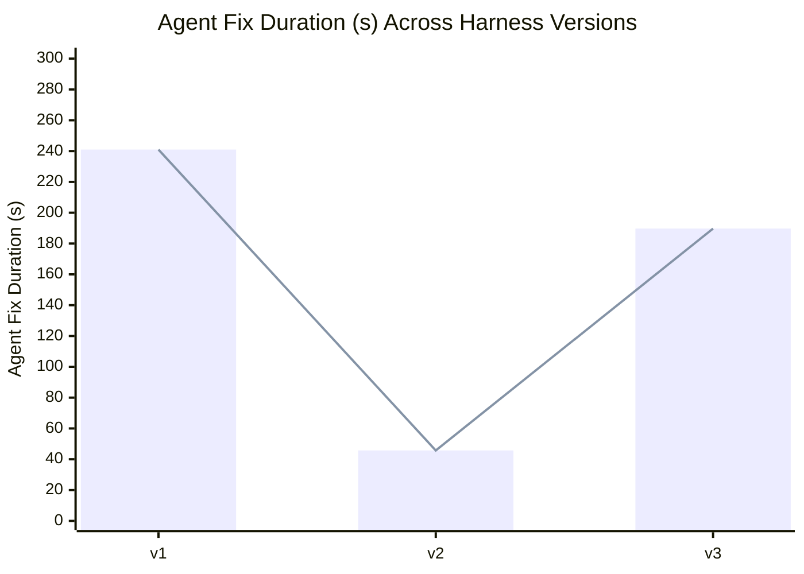

# CS 440 Lab 6 — Agent Algorithm-Fix Performance Report

SQLite Database: `harness_performance.db` | Total Runs: **3** | Baseline: **`v1`** (v1 Agent Fix Run)

---

## 1. Baseline (`v1`) vs. Latest (`v3`) Algorithm-Fix Speed

| Metric | Baseline (`v1`) | Latest (`v3`) | Delta / Status |
| :--- | :---: | :---: | :---: |
| **Agent Fix Duration** | `240.975 s` | `189.699 s` | `-51.2753 s (-21.3%)` |
| **Total Agent Tokens** | `n/a` | `53,210` | `in=48,261, out=4,949` |
| **Sub-Agents Invoked** | `unknown` | `issue-researcher, contributing-reviewer` | `issue-researcher` & `contributing-reviewer` |
| **Issue #15656 (`n=171`) Fix** | `RESOLVED` | `RESOLVED` | `maths/binomial_distribution.py` |
| **AST `CONTRIBUTING.md` Compliance** | `PASS` | `PASS` | `7` doctests |

---

## 2. Agent Fix Duration Trend (Seconds — Lower is Faster)

---

## 3. SQLite Run History (`agent_runs` Table)

| Run | Version | Change / Tuning | Duration | Delta vs. `v1` | Tokens | Sub-Agents | Verification |
| :---: | :--- | :--- | :---: | :---: | :---: | :--- | :--- |
| 1 | `v1` **(Baseline)** | v1 Agent Fix Run | `240.975s` | `0.0 s (0.0%)` | `n/a` | `unknown` | RESOLVED (7 doctests) |
| 2 | `v2` | v2 Fork-First + Live Console | `45.724s` | `-195.2511 s (-81.0%)` | `n/a` | `unknown` | RESOLVED (7 doctests) |
| 3 | `v3` | Deduplicated target config/frontmatter, added Makefile, fork cleanup, and detailed stream-json token/subagent telemetry | `189.699s` | `-51.2753 s (-21.3%)` | `53,210` | `issue-researcher, contributing-reviewer` | RESOLVED (7 doctests) |
