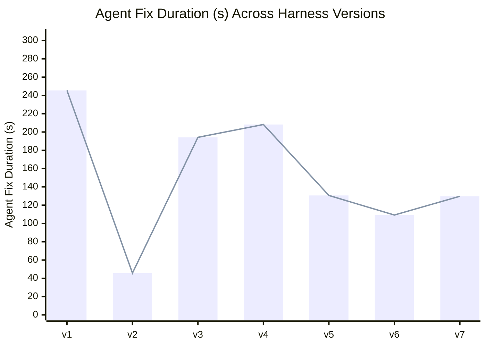

# CS 440 Lab 6 — Agent Algorithm-Fix Performance Report

SQLite Database: `harness_performance.db` | Total Runs: **7** | Baseline: **`v1`** (v1 Agent Fix Run)

---

## 1. Baseline (`v1`) vs. Latest (`v7`) Algorithm-Fix Speed

| Metric | Baseline (`v1`) | Latest (`v7`) | Delta / Status |
| :--- | :---: | :---: | :---: |
| **Normalized Duration (incl. Cold Fork)** | `245.475 s` | `129.762 s` | `-115.7121 s (-47.1%)` |
| **Total Agent Tokens** | `n/a` | `44,668` | `in=41,476, out=3,192` |
| **Sub-Agents Invoked** | `unknown` | `issue-researcher, contributing-reviewer` | `issue-researcher` & `contributing-reviewer` |
| **Issue #15656 (`n=171`) Fix** | `RESOLVED` | `RESOLVED` | `maths/binomial_distribution.py` |
| **AST `CONTRIBUTING.md` Compliance** | `PASS` | `PASS` | `7` doctests |

---

## 2. Agent Fix Duration Trend (Seconds — Lower is Faster)



---

## 3. SQLite Run History (`agent_runs` Table)

| Run | Version | Change / Tuning | Duration | Delta vs. `v1` | Tokens | Sub-Agents | Verification |
| :---: | :--- | :--- | :---: | :---: | :---: | :--- | :--- |
| 1 | `v1` **(Baseline)** | v1 Agent Fix Run | `245.475s` (`+4.5s` fork) | `0.0 s (0.0%)` | `n/a` | `unknown` | RESOLVED (7 doctests) |
| 2 | `v2` | v2 Fork-First + Live Console | `45.724s` (cold fork) | `-199.7511 s (-81.4%)` | `n/a` | `unknown` | RESOLVED (7 doctests) |
| 3 | `v3` | Deduplicated target config/frontmatter, added Makefile, fork cleanup, and detailed stream-json token/subagent telemetry | `194.199s` (`+4.5s` fork) | `-51.2753 s (-20.9%)` | `53,210` | `issue-researcher, contributing-reviewer` | RESOLVED (7 doctests) |
| 4 | `v4` | Added emoji & live sub-agent transcript streaming | `208.213s` (`+4.5s` fork) | `-37.2613 s (-15.2%)` | `73,886` | `issue-researcher, contributing-reviewer` | RESOLVED (7 doctests) |
| 5 | `v5` | Stripped Phase 1 hints, routed subagents to flash in parallel, set --effort medium, and avoided redundant context re-reads | `130.619s` (`+4.5s` fork) | `-114.8559 s (-46.8%)` | `38,084` | `issue-researcher, contributing-reviewer` | RESOLVED (7 doctests) |
| 6 | `v6` | Added fast_audit.py skill script, get_issue_root_cause_context & run_fast_compliance_audit MCP tools, and scoped subagents strictly to local repo | `109.192s` (`+4.5s` fork) | `-136.2823 s (-55.5%)` | `41,929` | `issue-researcher, contributing-reviewer` | RESOLVED (7 doctests) |
| 7 | `v7` | Added Main vs Sub-Agent duration/token breakdown and Issue #15656 code snippet + live test proof to PERFORMANCE_REPORT.md | `129.762s` (`+4.5s` fork) | `-115.7121 s (-47.1%)` | `44,668` | `issue-researcher, contributing-reviewer` | RESOLVED (7 doctests) |

---

## 4. Main Agent vs. Sub-Agent Breakdown (`v7`)

| Agent Role | Duration | Tokens | Responsibility |
| :--- | :---: | :---: | :--- |
| **Main Orchestrator** (`v7`) | `125.26 s` | `44,668` | Coordinates fork, sub-agents, PR & final verification |
| Sub-Agent: `contributing-reviewer` (`2eb5608c`) | `39.00 s` | `26,583` | Isolated context research / `CONTRIBUTING.md` audit |
| Sub-Agent: `issue-researcher` (`fbd44a9e`) | `25.00 s` | `23,548` | Isolated context research / `CONTRIBUTING.md` audit |

---

## 5. Phase 2 Deliverables, Issue `#15656` Fix & Passing Test Evidence

- **Modified Algorithm Target**: `maths/binomial_distribution.py` (fixed `float(factorial(trials))` `OverflowError` for `trials >= 171` using `math.comb` + log-space `lgamma`/`log`/`log1p`/`exp` fallback).
- **Generated Workflow Deliverables**: `src/__init__.py`, `src/compliance_checker.py`, `src/fork_pr_validator.py`, `tests/test_src_workflow.py`, `CONTRIBUTION_REPORT.md`

### Issue `#15656` Fix Implementation (`maths/binomial_distribution.py`)

```python
def binomial_distribution(successes: int, trials: int, prob: float) -> float:
    """
    Return probability of k successes out of n tries, with p probability for one
    success.

    Uses ``math.comb`` to avoid intermediate factorial float overflow, and falls
    back to log-space (``lgamma`` and ``log``) when large ``trials`` would
    overflow ``float`` or underflow intermediate powers.

    0.30870000000000003
    0.375
    0.060749764626165485
    0.017839011146
    Traceback (most recent call last):
        ...
    ValueError: successes must be lower or equal to trials
    Traceback (most recent call last):
        ...
    ValueError: the function is defined for non-negative integers
    Traceback (most recent call last):
        ...
    ValueError: prob has to be in range of 1 - 0
    """
    if successes > trials:
        raise ValueError("successes must be lower or equal to trials")
    if trials < 0 or successes < 0:
        raise ValueError("the function is defined for non-negative integers")
    if not isinstance(successes, int) or not isinstance(trials, int):
        raise TypeError("the function is defined for non-negative integers")
    if not 0 < prob < 1:
        raise ValueError("prob has to be in range of 1 - 0")
    probability = (prob**successes) * ((1 - prob) ** (trials - successes))
    if probability != 0.0:
        try:
            return probability * comb(trials, successes)
        except OverflowError:
            pass
    # Fall back to log-space when intermediate powers underflow or comb overflows float.
    log_coefficient = (
        lgamma(trials + 1) - lgamma(successes + 1) - lgamma(trials - successes + 1)
    )
    log_probability = successes * log(prob) + (trials - successes) * log1p(-prob)
    return exp(log_coefficient + log_probability)
```

### Live Passing Test & Compliance Proof

**1. `python3 -m doctest -v maths/binomial_distribution.py`:**

```text
Expecting:
    Traceback (most recent call last):
        ...
    ValueError: prob has to be in range of 1 - 0
ok
1 items had no tests:
    binomial_distribution
1 items passed all tests:
   7 tests in binomial_distribution.binomial_distribution
7 tests in 2 items.
7 passed and 0 failed.
Test passed.
```

**2. `fast_audit.py maths/binomial_distribution.py` (`CONTRIBUTING.md`, `ruff`, `mypy`, `pylint`):**

```json
{
  "target_file": "maths/binomial_distribution.py",
  "compliant": true,
  "doctests_passed": true,
  "ruff_ok": true,
  "mypy_ok": true,
  "pylint_ok": true,
  "lint_ok": true
}
```

**3. `pytest tests/test_src_workflow.py -q --tb=short` (Phase 2 `src/` Workflow Tests):**

```text
.....                                                                    [100%]
5 passed in 0.02s
```
