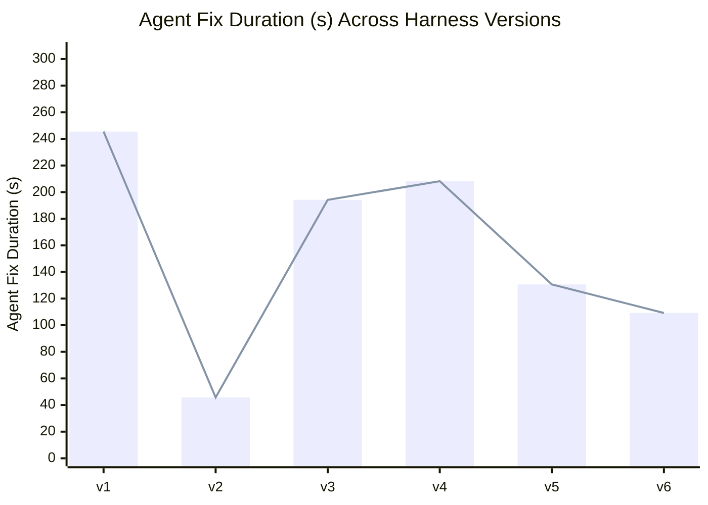

# CS 440 Lab 6 — Agent Algorithm-Fix Performance Report

SQLite Database: `harness_performance.db` | Total Runs: **6** | Baseline: **`v1`** (v1 Agent Fix Run)

---

## 1. Baseline (`v1`) vs. Latest (`v6`) Algorithm-Fix Speed

| Metric | Baseline (`v1`) | Latest (`v6`) | Delta / Status |
| :--- | :---: | :---: | :---: |
| **Normalized Duration (incl. Cold Fork)** | `245.475 s` | `109.192 s` | `-136.2823 s (-55.5%)` |
| **Total Agent Tokens** | `n/a` | `41,929` | `in=38,756, out=3,173` |
| **Sub-Agents Invoked** | `unknown` | `issue-researcher, contributing-reviewer` | `issue-researcher` & `contributing-reviewer` |
| **Issue #15656 (`n=171`) Fix** | `RESOLVED` | `RESOLVED` | `maths/binomial_distribution.py` |
| **AST `CONTRIBUTING.md` Compliance** | `PASS` | `PASS` | `7` doctests |

---

## 2. Agent Fix Duration Trend (Seconds — Lower is Faster)

---

## 3. SQLite Run History (`agent_runs` Table)

| Run | Version | Change / Tuning | Duration | Delta vs. `v1` | Tokens | Sub-Agents | Verification |
| :---: | :--- | :--- | :---: | :---: | :---: | :--- | :--- |
| 1 | `v1` **(Baseline)** | v1 Agent Fix Run | `245.475s` (`+4.5s` fork) | `0.0 s (0.0%)` | `n/a` | `unknown` | RESOLVED (7 doctests) |
| 2 | `v2` | v2 Fork-First + Live Console | `45.724s` (cold fork) | `-199.7511 s (-81.4%)` | `n/a` | `unknown` | RESOLVED (7 doctests) |
| 3 | `v3` | Deduplicated target config/frontmatter, added Makefile, fork cleanup, and detailed stream-json token/subagent telemetry | `194.199s` (`+4.5s` fork) | `-51.2753 s (-20.9%)` | `53,210` | `issue-researcher, contributing-reviewer` | RESOLVED (7 doctests) |
| 4 | `v4` | Added emoji & live sub-agent transcript streaming | `208.213s` (`+4.5s` fork) | `-37.2613 s (-15.2%)` | `73,886` | `issue-researcher, contributing-reviewer` | RESOLVED (7 doctests) |
| 5 | `v5` | Stripped Phase 1 hints, routed subagents to flash in parallel, set --effort medium, and avoided redundant context re-reads | `130.619s` (`+4.5s` fork) | `-114.8559 s (-46.8%)` | `38,084` | `issue-researcher, contributing-reviewer` | RESOLVED (7 doctests) |
| 6 | `v6` | Added fast_audit.py skill script, get_issue_root_cause_context & run_fast_compliance_audit MCP tools, and scoped subagents strictly to local repo | `109.192s` (`+4.5s` fork) | `-136.2823 s (-55.5%)` | `41,929` | `issue-researcher, contributing-reviewer` | RESOLVED (7 doctests) |
