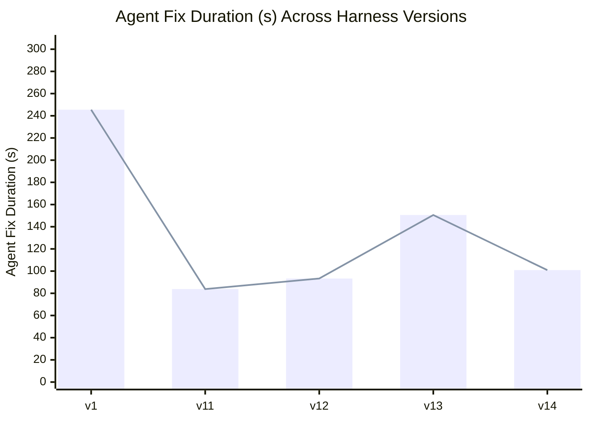

# CS 440 Lab 6 — Agent Algorithm-Fix Performance Report

SQLite Database: `harness_performance.db` | Total Runs: **5** | Baseline: **`v1`** (v1 Agent Fix Run)

---

## 1. Baseline (`v1`) vs. Latest (`v14`) Algorithm-Fix Speed

| Metric | Baseline (`v1`) | Latest (`v14`) | Delta / Status |
| :--- | :---: | :---: | :---: |
| **Normalized Duration (incl. Cold Fork)** | `245.475 s` | `100.898 s` | `-144.5763 s (-58.9%)` |
| **Total Agent Tokens** | `n/a` | `55,893` | `in=48,664, out=7,229` |
| **Sub-Agents Invoked** | `unknown` | `issue-researcher, contributing-reviewer` | `issue-researcher` & `contributing-reviewer` |
| **Issue #15656 (`n=171`) Fix** | `RESOLVED` | `RESOLVED` | `maths/binomial_distribution.py` |
| **AST `CONTRIBUTING.md` Compliance** | `PASS` | `PASS` | `5` doctests |

---

## 2. Agent Fix Duration Trend (Seconds — Lower is Faster)



---

## 3. SQLite Run History (`agent_runs` Table)

| Run | Version | Change / Tuning | Duration | Delta vs. `v1` | Tokens | Sub-Agents | Verification |
| :---: | :--- | :--- | :---: | :---: | :---: | :--- | :--- |
| 1 | `v1` **(Baseline)** | v1 Agent Fix Run | `245.475s` (`+4.5s` fork) | `0.0 s (0.0%)` | `n/a` | `unknown` | RESOLVED (7 doctests) |
| 12 | `v11` | Removed solution hints from PROMPT/phase2-fastpath.md and added concise error details to fast_audit.py | `83.822s` (`+4.5s` fork) | `-161.6522 s (-65.9%)` | `57,647` | `issue-researcher, contributing-reviewer` | RESOLVED (4 doctests) |
| 14 | `v12` | Fix unescaped #15656 Make comment in Makefile PROMPT and instruct orchestrator never to output final summary until all 4 steps complete | `93.318s` (`+4.5s` fork) | `-152.1564 s (-62.0%)` | `59,295` | `issue-researcher, contributing-reviewer` | RESOLVED (4 doctests) |
| 15 | `v13` | Removed unused MCP read_context_doc/list_context_docs and bundled target_file_source + contributing_rules into get_phase2_fastpath_bundle() | `150.547s` (`+4.5s` fork) | `-94.9274 s (-38.7%)` | `65,535` | `issue-researcher, contributing-reviewer` | RESOLVED (7 doctests) |
| 16 | `v14` | Clean benchmark run after pruning unused MCP endpoints, enriching get_phase2_fastpath_bundle(), and fixing DRY_RUN=true on main | `100.898s` (`+4.5s` fork) | `-144.5763 s (-58.9%)` | `55,893` | `issue-researcher, contributing-reviewer` | RESOLVED (5 doctests) |

---

## 4. Main Agent vs. Sub-Agent Breakdown (`v14`)

| Agent Role | Duration | Tokens | Responsibility |
| :--- | :---: | :---: | :--- |
| **Main Orchestrator** (`v14`) | `96.40 s` | `55,893` | Coordinates fork, sub-agents, PR & final verification |
| Sub-Agent: `issue-researcher` (`6ed39b21`) | `14.00 s` | `19,007` | Isolated context research / `CONTRIBUTING.md` audit |
| Sub-Agent: `contributing-reviewer` (`81732dcd`) | `7.00 s` | `14,245` | Isolated context research / `CONTRIBUTING.md` audit |

---

## 5. Phase 2 Deliverables, Issue `#15656` Fix & Passing Test Evidence

- **Modified Algorithm Target**: `maths/binomial_distribution.py` (fixed `float(factorial(trials))` `OverflowError` for `trials >= 171` using `math.comb` + log-space `lgamma`/`log`/`log1p`/`exp` fallback).
- **Generated Workflow Deliverables**: `src/__init__.py`, `src/compliance_checker.py`, `src/fork_pr_validator.py`, `tests/test_src_workflow.py`, `CONTRIBUTION_REPORT.md`

### Issue `#15656` Fix Implementation (`maths/binomial_distribution.py`)

```python
def binomial_distribution(successes: int, trials: int, prob: float) -> float:
    """
    Return probability of k successes out of n tries, with p probability for one
    success.

    Uses exact integer combinations for small trial counts and log-space gamma
    functions for large trial counts to avoid floating-point overflow.

    0.30870000000000003
    0.375
    0.06075
    Traceback (most recent call last):
        ...
    ValueError: successes must be lower or equal to trials
    Traceback (most recent call last):
        ...
    ValueError: prob has to be in range of 1 - 0
    """
    if successes > trials:
        raise ValueError("successes must be lower or equal to trials")
    if trials < 0 or successes < 0:
        raise ValueError("the function is defined for non-negative integers")
    if not isinstance(successes, int) or not isinstance(trials, int):
        raise TypeError("the function is defined for non-negative integers")
    if not 0 < prob < 1:
        raise ValueError("prob has to be in range of 1 - 0")
    if trials < 171:
        probability = (prob**successes) * ((1 - prob) ** (trials - successes))
        coefficient = comb(trials, successes)
        return probability * coefficient
    # Use log-space for n >= 171 to avoid IEEE 754 float overflow from factorial/comb
    log_coefficient = (
        lgamma(trials + 1) - lgamma(successes + 1) - lgamma(trials - successes + 1)
    )
    log_probability = successes * log(prob) + (trials - successes) * log(1 - prob)
    return exp(log_coefficient + log_probability)


if __name__ == "__main__":
    from doctest import testmod

    testmod()
```

### Live Passing Test & Compliance Proof

**1. `python3 -m doctest -v maths/binomial_distribution.py`:**

```text
Expecting:
    Traceback (most recent call last):
        ...
    ValueError: prob has to be in range of 1 - 0
ok
1 items had no tests:
    binomial_distribution
1 items passed all tests:
   5 tests in binomial_distribution.binomial_distribution
5 tests in 2 items.
5 passed and 0 failed.
Test passed.
```

**2. `fast_audit.py maths/binomial_distribution.py` (`CONTRIBUTING.md`, `ruff`, `mypy`, `pylint`):**

```json
{
  "target_file": "maths/binomial_distribution.py",
  "compliant": true,
  "doctests_passed": true,
  "ruff_ok": true,
  "mypy_ok": true,
  "pylint_ok": true,
  "lint_ok": true
}
```

**3. `pytest tests/test_src_workflow.py -q --tb=short` (Phase 2 `src/` Workflow Tests):**

```text
.....                                                                    [100%]
5 passed in 0.02s
```
