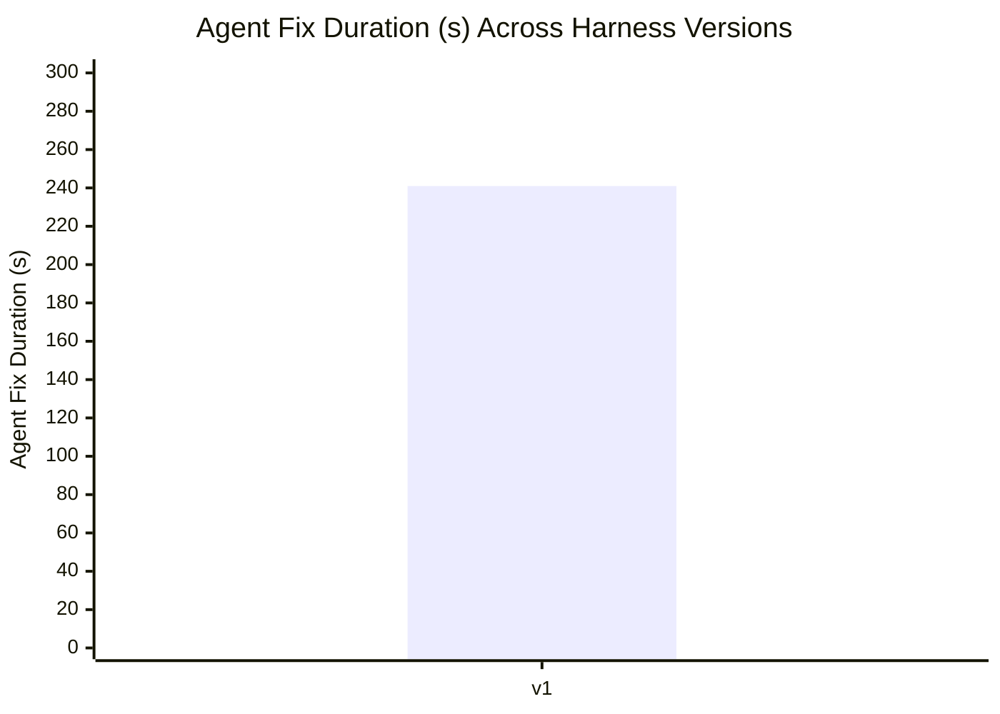

# CS 440 Lab 6 — Agent Algorithm-Fix Performance Report

SQLite Database: `harness_performance.db` | Total Runs: **1** | Baseline: **`v1`** (v1 Agent Fix Run)

---

## 1. Baseline (`v1`) vs. Latest (`v1`) Algorithm-Fix Speed

| Metric | Baseline (`v1`) | Latest (`v1`) | Delta vs. Baseline |
| :--- | :---: | :---: | :---: |
| **Agent Fix Duration** | `240.975 s` | `240.975 s` | `0.0 s (0.0%)` |
| **Issue #15656 (`n=171`) Fix** | `RESOLVED` | `RESOLVED` | `maths/binomial_distribution.py` |
| **AST `CONTRIBUTING.md` Compliance** | `PASS` | `PASS` | `7` doctests |
| **Doctest Execution Time** | `5.76 ms` | `5.76 ms` | `0.0 ms (0.0%)` |

---

## 2. Agent Fix Duration Trend (Seconds — Lower is Faster)

---

## 3. SQLite Run History (`agent_runs` Table)

| Run | Version | Harness / Prompt Tuning | Agent Fix Duration | Delta vs. `v1` | Issue #15656 | Compliance & Doctests |
| :---: | :--- | :--- | :---: | :---: | :--- | :--- |
| 1 | `v1` **(Baseline)** | v1 Agent Fix Run | `240.975s` | `0.0 s (0.0%)` | RESOLVED | PASS (7 doctests, `5.76 ms`) |
