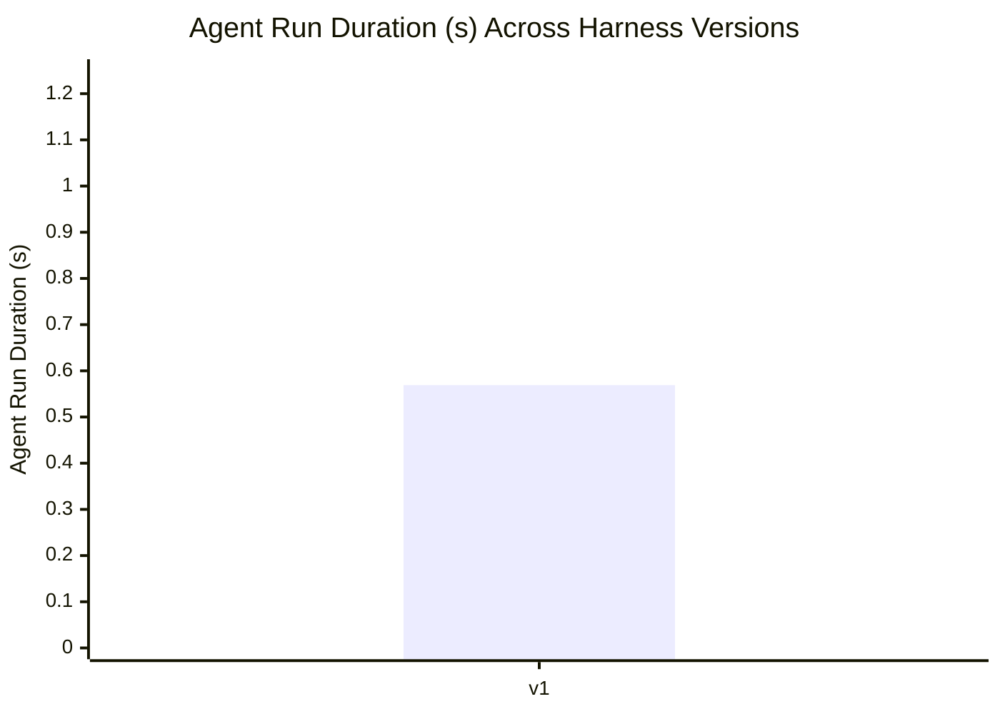
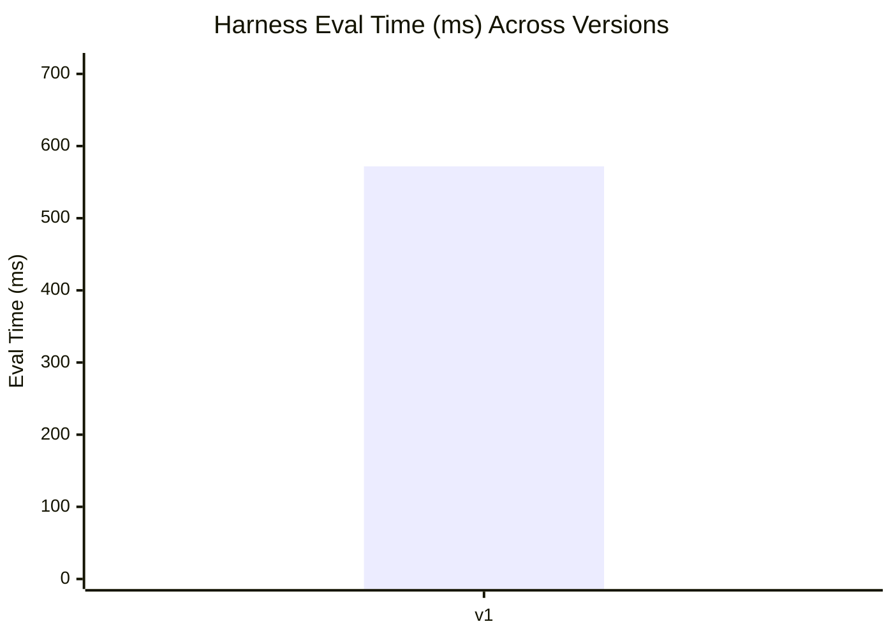

# CS 440 Lab 6 — Agent & Harness Performance Report

SQLite Database: `harness_performance.db` | Total Runs Recorded: **1** | Baseline Version: **`v1`** (v1 Baseline Harness)

---

## 1. Baseline (`v1`) vs. Latest (`v1`) Comparison

| Metric | Baseline (`v1`) | Latest (`v1`) | Delta vs. Baseline |
| :--- | :---: | :---: | :---: |
| **Agent Run Duration** | `0.569 s` | `0.569 s` | `0.0 s (0.0%)` |
| **Harness Test Eval Speed** | `571.9 ms` | `571.9 ms` | `0.0 ms (0.0%)` |
| **Harness Readiness Score** | `100.0%` | `100.0%` | `0.0 % (0.0%)` |
| **Context Compression (Strategy 3)** | `81.0%` | `81.0%` | `606 / 3191 tokens` |
| **Skill Startup Savings (Strategy 2)** | `53.6%` | `53.6%` | Frontmatter-only load |
| **Issue #15656 (`n=171`) Benchmark** | `UNRESOLVED` | `UNRESOLVED` | `5.4 ms` (`2` doctests) |

---

## 2. Agent Run Duration Trend (Seconds — Lower is Faster)



---

## 3. Harness Test Evaluation Speed (ms) & Readiness (%)



```mermaid
xychart-beta
    title "Harness Readiness Score (%) Across Versions"
    x-axis ["v1"]
    y-axis "Readiness (%)" 0 --> 100
    line [100.0]
```

---

## 4. SQLite Run History (`agent_runs` Table)

| Run | Version | Tuning Milestone | Agent Time | Delta vs. `v1` | Harness Eval | Readiness | Token Compression | Issue #15656 |
| :---: | :--- | :--- | :---: | :---: | :---: | :---: | :---: | :--- |
| 1 | `v1` **(Baseline)** | v1 Baseline Harness | `0.569s` | `0.0 s (0.0%)` | `571.9 ms` | **100.0%** (18/18) | 81.0% | Phase 2 Pending |
